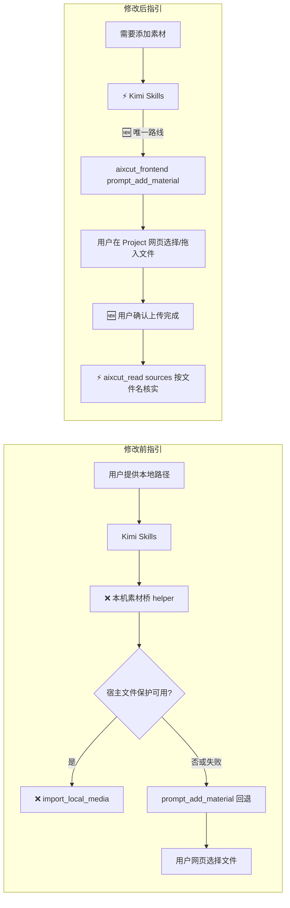

# Kimi 插件仅使用网页素材上传：方案与实施计划

## 需求与成功标准

Kimi 当前执行环境没有宿主注入的受控文件访问配置。本版本不再让 Kimi 尝试启动本机素材桥或通过本地路径导入；需要素材时，只打开 Aixcut Project 的上传区，由用户选择或拖入文件，随后读取 `sources` 按文件名确认。

成功标准：

- Kimi 的 Host、Timeline Editing、Known Errors、Video Assembly 指引及相关参考文档只描述“打开网页上传区 → 用户选择文件 → 读 `sources` 核实”这一条本地素材路线。
- 指引里不再出现本机素材桥、桥 helper 命令、桥 URL 重试、`import_local_media`、`import_status` 轮询等旧路线文字；不写“禁止起桥”之类的反向提示，避免把旧路线重新带回模型上下文。
- 只修改 Kimi 插件的 Skills、测试与文档；不修改 MCP Server、WorkBuddy 或共享 Core。
- `scripts/local-media-bridge.mjs` 及其安全回归测试保持原样，只是 Kimi 指引不再暴露该入口。

## 当前与目标流程

图例：🆕 新增或明确的行为；⚡ 修改后的行为；❌ 从 Kimi 指引中移除的路径。

差异说明：删除 Kimi 指引中的双路径（先起桥、失败回退）与全部桥接文字，只保留网页选择这一条路线；不改变 MCP Server 的工具契约，也不改变 helper 代码本身。

## 实施步骤（TDD）

1. 修改 `tests/skill-guidance.test.mjs`：先把原有桥接优先断言改为“仅网页选择”，并覆盖 Host、Timeline、Known Errors、动作参考及 Assembly 流程；断言桥接关键字不存在。运行该测试，确认因当前文档仍描述桥接而失败。
2. 更新 `skills/aixcut-host/SKILL.md`、`skills/aixcut-timeline-editing/SKILL.md`、`skills/aixcut-known-errors/SKILL.md` 与 Basics readiness guidance，只写唯一路线、用户选择时机、上传确认与 sources 核验。
3. 更新 Timeline 的 `references/actions.md`、`references/frontend-actions.md` 与 Video Assembly Skill/pipeline，删除桥接操作与 `import_local_media`、`import_status` 相关行，改为网页上传说明。
4. 重跑专项 Skill 指引测试；全部实现稳定后运行一次 `npm run check`，确认插件结构、Skill/Tool 闭包与原有桥接安全测试仍通过。

本计划不授权提交、推送或创建 PR；交付前先报告分支、文件、测试和建议提交信息。
