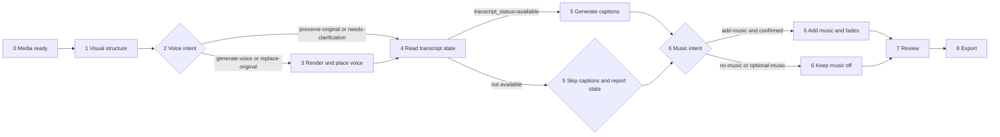

# Aixcut Video Assembly

Use the packaged shared [orchestration](../../references/core/orchestration.md) and [quality gates](../../references/core/quality-gates.md) as the common policy; keep browser handoff and local-file operations in the Kimi host and specialist Skills.

## Conversation guidance

Keep the user oriented at each stage without turning the workflow into a fixed questionnaire. If the goal is clear, inspect the Project and media, then continue safe work. Pause only for a consequential unresolved choice, permission, unaccepted cost or credits, or overwrite/deletion risk. At handoffs, state what is complete, what is next, and whether the user needs to act.

This Skill owns the order and dependencies between stages; each specialist Skill owns its detailed procedure. A finished video must meet the user's visual, audio, and text requirements.

## Scope

Use this Skill for multi-stage work, such as turning source media into a 60-second promo with voiceover, captions, and music, or shortening a video and adding narration. For a single caption, clip replacement, or export, use the corresponding specialist Skill directly.

## Align before acting

Resolve only relevant decisions that are still missing; treat this list as a guide, not a questionnaire:

1. **Video goal:** duration, aspect ratio, platform, and use.
2. **Audio:** voiceover? Background music? Should music sit below original audio?
3. **Text:** captions? Should they follow the voice script or source speech?
4. **Media:** use existing assets or ask the user to upload more?
5. **Content language:** follow the language policy. Do not infer the finished video's language solely from the conversation language.

Keep spoken captions and visual annotations as separate requirements. Captions follow spoken words; animated ingredient labels, arrows, circles, and callouts belong to the corresponding visual moments. Verify both categories independently; one does not replace the other.

Visual annotations are a separate stage before caption generation. Classify each requested element as a spoken caption, static art text, or Motion Graph, place it on its dedicated track, and verify its clip kind and track before moving to captions.

If the user requests multiple versions, A/B, portrait/landscape, or platform variants, first call `aixcut_timeline(action="list")` and duplicate a timeline per version. Include each version's `timeline_id` in later reads/writes. Generated assets are Project-scoped and can be reused; do not regenerate them for each version.

Ask one concise question at a time. If the user requests uninterrupted end-to-end execution, use reasonable reversible defaults for non-blocking choices and report them. Still resolve choices that materially change the content language, incur an unaccepted charge, or risk overwriting existing work.

## Audio intent gate

Before choosing any audio action, read the Project, current Timeline, source audio and existing voice or narration, existing music, and each relevant source's `transcript_status`. Do not infer an audio request from the fact that this Skill is being used. Classify the request with these explicit states:

- `preserve-original`: keep the existing source audio or correct narration and do not create AI voice.
- `generate-voice`: the user explicitly requests new AI narration; enter the voice render flow.
- `replace-original`: the user explicitly requests replacing existing speech; render and place only the requested replacement range.
- `add-music`: the user explicitly requests background music or confirms a music choice; add a separate music track.
- `no-music`: the user explicitly says not to add music; do not generate or add one.
- `optional-music`: the user says music is optional, or does not mention music; default to no music and ask for confirmation before adding one.
- `needs-clarification`: the presence or replacement of speech would materially change the result and the user has not said which behavior they want; ask one concise question before rendering.

An existing correct voice, speech, or narration is preserved by default. Only generate AI voice when the user explicitly requests it, or when `replace-original` has been resolved. A request to edit visuals, captions, or timing alone never authorizes new voice generation. Optional or unmentioned music defaults to not adding music; add it only after an explicit request or user confirmation. Do not change MCP schemas or tool fields to represent these states.

## Required order

Visual structure always runs. Voice and music are conditional stages; keep the dependency order below:

The effective order is visual structure → conditional voice → captions from a real `transcript_status=available` source → confirmed music → review/export.

1. **Media ready:** Read the Project and check whether assets and analysis are ready. Resolve missing media or analysis first. If the user needs to add files, follow “Local media” in `aixcut-timeline-editing`; continue only after the assets appear in `sources`.
2. **Visual structure:** Arrange shots and durations to fit the target. This determines the required voice length.
3. **Voice intent and script:** For `preserve-original`, reuse the source voice and skip synthesis. For `generate-voice` or `replace-original`, write the script in the requested content language, choose a voice profile, and submit synthesis. If the state is `needs-clarification`, pause for the one missing decision.
4. **Place and transcribe voice:** Run this stage only for a requested generated or replacement voice. Successful synthesis only means the audio asset exists. Place it on the timeline, then read the source `transcript_status`. Only `available` is ready for automatic captions; report pending or failed status accurately.
5. **Captions:** Generate captions only when the audio that is actually on the timeline has `transcript_status=available`. Never use the voice script as a transcript or claim transcription is complete from the script alone. If the status is not `available`, skip automatic captions and report the returned state.
6. **Background music:** Add a separate audio track only for `add-music` after explicit user request or confirmation. For `no-music` and `optional-music`, do not generate or add music. When enabled, add fades at both ends; after read-back, lower the created clip with `aixcut_audio(action="update", target="clip:...", volume=0.2–0.4)` so narration remains clear.
7. **Review:** Read the timeline, source audio, voice state, transcript status, captions, and music state and check each stated requirement. Verify captions and visual annotations independently; the caption track must contain only spoken subtitle clips, while art text and Motion Graphs remain on their dedicated tracks.
8. **Export (only when requested):** Run this stage once, after every requested stage is finished, and only when the user requested or explicitly authorized an export; never export between stages. Use `aixcut-export` to export from the Project page and poll status. The browser downloads the file; report its filename and size.

Detailed stage instructions are in [references/pipeline.md](references/pipeline.md).

## Stage handoffs

Stage changes are status updates, not confirmation gates. After laying out visuals, report pacing and continue to the resolved voice branch. Do not synthesize when `preserve-original` applies. After placing requested voice, report the script and voice profile, then continue to captions only after a real `transcript_status=available` read. Add music only after `add-music` is explicitly requested or confirmed. Intermediate stages never export; the single optional export happens after the resolved stages. Before export, summarize the structure and verified checks.

Pause only when available media cannot meet the goal, different interpretations would produce materially different edits, a generation charge or credits have not been accepted, existing work may be overwritten or deleted, or the user asked to review before continuing. Ask only about the most important unresolved choice and recommend an option.

For upload, asynchronous generation, voice rendering, transcription, or export, continue status checks when possible. If user action is required, state the exact action and what will allow work to resume.

## Common misses

- **Rendered voice is not yet in the video.** Synthesis creates an audio asset; place it on an audio track separately.
- **Captions are not automatically the voice script.** A visual-only source may have no transcript. For narration, check the audio transcript state after placing voice.
- **Voice generation does not imply captions exist.** Wait for `transcript_status=available`, regenerate captions, and read them back.
- **A complete assembly request does not imply voice or music.** Honor the resolved intent state and keep optional or unmentioned music off.
- **Music needs fades.** Without fades, it can start or stop abruptly.
- **Do not invent beat-analysis actions.** Use only the published frontend operations. If beat evidence is unavailable, report that beats could not be determined; do not estimate BPM by ear.
- **Balance voice and music.** Music overpowering narration is a common quality issue.
- **The browser owns local source files.** Full local video is not uploaded. Audio may be extracted for transcription and visual understanding uses on-demand frame capture. The Project page performs final export; do not treat local originals as missing.

## Completion

Each user requirement must map to a read-back result. Usually call `aixcut_read(view="timeline")`, `aixcut_read(view="speech")`, and `aixcut_read(view="captions")`, then inspect structure with `aixcut_review(view="timeline")`.

Report total duration, visual clip count, voice segment count and duration, caption count, and music track and fades. Report export status only when the user requested an export. State any incomplete work plainly. If the exported file was not actually played, say “full playback/listening not verified.”

## Plan and evidence artifacts

Before structural writes, form an `EditPlan` with intent, constraints, audio state, transcript dependencies, requested deliverable and export authorization. Form a `ShotPlan` for visual structure with source refs, in/out ranges, output ranges, visible subject and evidence needed for each claim. After each atomic batch save a `Checkpoint` containing the latest revision and affected refs. Finish with `ReviewEvidence` that separates structure, semantic, visual and audio findings; a tool `applied` response alone is not evidence of a good cut. Export only when the user requested or explicitly authorized export.

If transcript generation is queued, processing, interrupted, stale or unknown, preserve the source/media identity and resume its existing operation when the live state permits. Do not re-import or fabricate captions from a script. If a speech submission is unknown, recover its exact frozen quote and operation identities before planning dependent captions.
